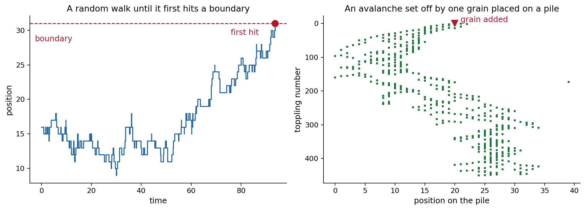

# MarkovMPS

A solver for continuous-time Markov processes on a lattice, computing first-passage statistics and avalanche-size distributions. The probability vector is stored as a tensor train and the generator as a matrix product operator, with the escape diagonal computed from the off-diagonal part so probability conservation holds by construction. Each observable is obtained by the solver it calls for: hitting times, splitting probabilities, and the generating function E[z^S] are alternating linear solves; the slowest decay rate of a detailed-balance walk is a symmetric eigensolve; a survival curve is a truncated-Taylor stepper.

Two problem families are included. The biased walk between absorbing barriers covers the first-passage observables; the Manna fixed-energy sandpile covers the avalanche observables, with its conserved grain number entering as a diagonal sector projector. The package is provided as two independent pipelines, a Julia package under [Julia/](Julia/) and a Python package under [Python/](Python/), with the same structure and conventions; every step below gives the command for each. The problem instances under `problems/`, the design documents under `docs/`, and the runtime output under `results/` are shared and live at the repository root.



## Install

You need git, and at least one of Julia and Python; each pipeline is complete on its own. If you do not have Julia, install version 1.10 or later from the Julia website (julialang.org). Python 3.11 or later comes preinstalled on most systems; if not, install it from python.org.

Clone the repository once and step into it; every command below is then a copy and paste from this directory:

    git clone https://github.com/monalisasroy/MarkovMPS.git
    cd MarkovMPS

Julia: install the dependencies and confirm with the test suite. The dependencies are the standard libraries LinearAlgebra, Random, and TOML, plus Plots for figures; the tensor-train core is implemented in the package directly, so there is no tensor-network dependency to install.

    julia --project=Julia -e 'using Pkg; Pkg.instantiate()'
    julia --project=Julia -e 'using Pkg; Pkg.test()'

Python: first confirm the interpreter is new enough, because a too-old default fails with an unreadable message about setuptools rather than naming the real problem:

    python3 --version

If this prints less than 3.11, install a newer Python (from python.org, or `brew install python@3.12` on macOS) and use its versioned name, `python3.12`, in place of `python3` in every command below; a virtual environment created with it makes plain `python` correct inside that environment. Then install the package and confirm with the test suite. The dependencies are numpy, scipy, and matplotlib, with pytest as the development extra, and the one command installs them all.

    python3 -m pip install -e "Python[dev]"
    python3 -m pytest Python/tests

If pip refuses to install outside a virtual environment, create one and install inside it; this block is the whole procedure:

    python3 -m venv Python/.venv
    source Python/.venv/bin/activate
    python3 -m pip install --upgrade pip
    python3 -m pip install -e "Python[dev]"
    python3 -m pytest Python/tests

The environment stays active for the rest of the shell session, so every Python command below runs inside it unchanged; in a new session, reactivate it first with `source Python/.venv/bin/activate`. Running `bash Python/setup.sh` performs the same steps.

## Running

The quickest reproducible run is a named problem instance. This computes the avalanche-size distribution of the small Manna ring with all three engines and writes its table and figure under `results/` at the repository root.

Julia:

    julia --project=Julia Julia/run.jl --problem manna_small

Python:

    python3 Python/run.py --problem manna_small

For a first look with parameters of your own, a flag run on a small system finishes in seconds.

Julia:

    julia --project=Julia Julia/run.jl --kind barrier_survival --nbits 4 --rate-up 1.3 --rate-down 0.7 --tmax 6

Python:

    python3 Python/run.py --kind barrier_survival --nbits 4 --rate-up 1.3 --rate-down 0.7 --tmax 6

Either way, open the `.png` the run names under `results/julia/figures/` or `results/python/figures/`: the observable from every engine the run used, drawn together. The matching `.tsv` beside it carries the numbers, one row per engine with its deviation from the anchor.

## Problem instances

The committed regimes are named parameter files under `problems/` at the repository root, so a run is reproduced by name rather than by retyping flags:

    julia --project=Julia Julia/run.jl --problem barrier        # Julia
    python3 Python/run.py --problem barrier                  # Python
    python3 Python/run.py --problem all                      # every instance

| instance | parameters | what it shows |
|---|---|---|
| barrier | 4 binary sites, rates 1.3 up and 0.7 down | the survival curve of an upward-biased walk between absorbing barriers |
| barrier_mfpt | 5 binary sites, rates 0.8 up and 1.1 down | the mean first-passage time of a downward-biased walk |
| manna_small | 4-site ring, 3 grains | the avalanche-size distribution from all three engines, including its tail |
| manna_critical | 24-site ring, 21 grains (density 0.875) | the distribution near the critical density of the conserved class; Monte Carlo alone, the stated boundary of the tensor-train method |

A TOML file names a run completely: the model, its parameters, the observable kind, and the engines. A new instance is a copy of an existing file with the values changed, runnable from either pipeline:

    cp problems/manna_small.toml problems/manna_ring8.toml
    # edit name, sites, grains, and smax in the copy; the output tag is
    # built from the name field, so an unchanged name overwrites the
    # original instance's files

The loader validates strictly: a misspelled or unknown field errors with a message naming the field and the allowed set, rather than running with a wrong default.

## Setting parameters

Parameters come from one of three places: the defaults built into the entry point, a problem instance under `problems/` run with `--problem NAME`, and the command-line flags of a flag run. The flags are identical in the two pipelines. Each run reports the table and figure it wrote.

| Flag | Type | Default | Meaning |
|---|---|---|---|
| `--kind` | name | barrier_survival | barrier_survival, barrier_mfpt, manna_avalanche, or manna_survival |
| `--nbits` | int | 4 | binary sites of the biased walk, so the range is 2^nbits positions |
| `--rate-up` | float | 1.0 | upward hop rate of the walk |
| `--rate-down` | float | 1.0 | downward hop rate of the walk |
| `--start` | int | half range | starting position of the walk |
| `--sites` | int | 6 | Manna ring size |
| `--grains` | int | 4 | Manna grain count |
| `--tmax` | float | 10.0 | longest time on a survival curve |
| `--tpoints` | int | 21 | number of times on a survival curve |
| `--smax` | int | 60 | largest avalanche size resolved |
| `--nshots` | int | 2000 | Monte Carlo trajectories |
| `--seed` | int | 1 | Monte Carlo seed, without which a sampled run is not reproducible |
| `--engines` | names | exact kmc tt | any subset of the three engines |
| `--output-dir` | path | results/julia or results/python at the root | directory for run files |

## Sweeps

Every parameter flag takes one or more values, and a flag given several values repeats the run over every combination in one invocation, so a sweep is one command rather than a shell loop:

    julia --project=Julia Julia/run.jl --kind manna_avalanche --sites 4 5 6 --grains 3    # Julia
    python3 Python/run.py --kind manna_avalanche --sites 4 5 6 --grains 3              # Python

Output tags are built from the fields the run kind reads, so no two combinations collide on a filename. A long sweep can be detached and stopped from the shell; the Python form is the same with `python3 Python/run.py`:

    nohup julia --project=Julia Julia/run.jl --kind manna_avalanche --sites 4 5 6 8 \
      --output-dir results/julia/sweep > sweep.log 2>&1 & echo $! > sweep.pid
    tail -f sweep.log
    kill "$(cat sweep.pid)" 2>/dev/null

## Worked example

Julia, from a REPL started with `julia --project=Julia` in this directory:

```julia
using MarkovMPS

pile = MannaSandpile(4, 3)                        # 4-site ring, 3 grains

mean_s, residual = tt_mean_avalanche_size(pile)   # one linear solve at z = 1
dist = exact_avalanche_size_distribution(pile, 800)
sizes = kmc_avalanche_sizes(pile, 4000, 1)        # 4000 Gillespie trajectories
```

Python, from any Python session after the install:

```python
from markovmps import BiasedWalk, MannaSandpile
from markovmps.solvers import (tt_mean_avalanche_size,
                               exact_avalanche_size_distribution,
                               kmc_avalanche_sizes)

pile = MannaSandpile(4, 3)                        # 4-site ring, 3 grains

mean_s, residual = tt_mean_avalanche_size(pile)   # one linear solve at z = 1
dist = exact_avalanche_size_distribution(pile, 800)
sizes = kmc_avalanche_sizes(pile, 4000, 1)        # 4000 Gillespie trajectories
```

The three engines answer the same question and any of them can be run alone; exchanging one for another changes nothing downstream. The notebook [notebooks/markovmps_walkthrough.ipynb](notebooks/markovmps_walkthrough.ipynb) walks the same path end to end with the Python package: the walk against its closed forms, the bond-dimension convergence, and the avalanche-size distribution from all three engines.

## What it computes

For the biased walk: the splitting probability, the mean first-passage time, the survival curve, and the slowest decay rate. For the Manna sandpile: the survival of activity, the generating function E[z^S] at any z, the mean avalanche size, and the full avalanche-size distribution, obtained by solving the generating function on the unit circle and inverting by a Fourier sum. Every run writes the data as a tab-separated table; classification, fitting, and publication figures are the reader's own analysis, and [docs/notes.md](docs/notes.md) states that boundary.

## Method

A model declares its process twice: `moves()` gives the state-space definition consumed by the exact engine and Monte Carlo, and `terms()` gives the operator definition consumed by the tensor-train path. One solver serves each observable, with the solution rank adapted by SVD and the residual reported beside the answer. The derivations and the pipeline flowchart are in [docs/algorithm.md](docs/algorithm.md); a new model is one file under the pipeline's `models/` directory, and [docs/adding_a_model.md](docs/adding_a_model.md) gives the interface.

## Layout

    MarkovMPS/
    ├── README.md                    # this file: context, usage, method, layout
    ├── LICENSE  CITATION.cff        # Apache 2.0 licence; software citation
    ├── problems/                    # committed TOML instances, shared by both pipelines
    ├── docs/                        # the algorithm, the model interface, the scope note, the hero image
    ├── results/                     # runtime output (results/julia/, results/python/), never committed
    ├── notebooks/                   # markovmps_walkthrough.ipynb, an example notebook illustrating the package
    ├── Julia/
    │   ├── Project.toml
    │   ├── run.jl                   # CLI entry point: named instances and flag sweeps
    │   ├── src/                     # tensortrain, generator, solvers, utils, plot_utils, models/
    │   ├── test/                    # one test file per source module
    │   └── examples/                # commented runs of the committed instances
    └── Python/
        ├── pyproject.toml
        ├── run.py                   # CLI entry point: named instances and flag sweeps
        ├── src/markovmps/           # tensor_train, generator, solvers, utils, plot_utils, models/
        ├── tests/                   # one test file per source module
        └── examples/                # commented runs of the committed instances

## Note on cost

The reachable system size is set by the bond dimension the distribution demands. Larger systems require a higher bond dimension and take longer to run, and mixed or near-critical regimes more so, which is why `manna_critical` runs the Monte Carlo engine.

## Status

Version 1.0.0: the command-line interface, the problem-instance format, and the public function names are stable, and a breaking change to any of them moves the major version. The run kinds dispatched are the survival curve, the mean first-passage time, and the avalanche-size distribution. Both test suites pass natively, Julia 1.12 and Python 3.12 on macOS arm64, and the committed Manifest.toml pins the Julia environment from that run. The conserved grain number is exploited through a projector rather than block-sparse quantum-number indices, which caps the size gain relative to a dedicated tensor-network backend.

## Licence and citation

Apache 2.0 ([LICENSE](LICENSE)); citation metadata in [CITATION.cff](CITATION.cff).
