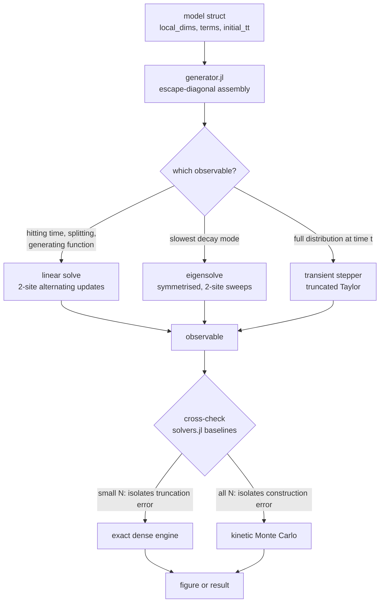

# The algorithm, from problem definition to checked result

MarkovMPS turns a continuous-time Markov process into a tensor-train computation in four steps: a model declares its state space and transition terms; one assembly function builds the generator with its escape diagonal, so every column sums to 0 by construction; the solver is selected from the observable rather than one propagator serving everything; and every tensor-train number is cross-checked against two permanent baselines before it becomes a figure. This page states the pipeline, the solver map, and the two linear systems the package solves, with the derivations a reader needs to verify each equation from the code.

This structure makes a new Markov problem a new struct in one file, since the generator assembly and the solvers never change. The reachable system size is set by the bond dimension the distribution demands, and near a critical point that demand grows, which is why the sampler remains a permanent engine of the package.

## Contents

- [Pipeline](#pipeline)
- [One solver per observable](#one-solver-per-observable)
- [The hitting-time system](#the-hitting-time-system)
- [The avalanche generating function](#the-avalanche-generating-function)
- [The conserved-sector projector](#the-conserved-sector-projector)
- [The symmetrised eigensolve](#the-symmetrised-eigensolve)
- [The transient stepper and its error](#the-transient-stepper-and-its-error)
- [What sets the reachable system size](#what-sets-the-reachable-system-size)

## Pipeline

The two baselines separate failure causes. The exact engine builds the dense generator from the model's `moves()` and applies no truncation, so a disagreement with it isolates a tensor-train truncation error. Kinetic Monte Carlo samples the same `moves()` with no operator at all, so a disagreement with it at a size both methods reach isolates an error in the operator assembly. The tensor-train verbs build the process from `terms()` instead, so agreement across the paths checks the assembly itself rather than one code path against a copy of itself.

## One solver per observable

Neither headline observable is a real-time-evolution problem, so time-dependent propagation is not the efficient centre. The generator restricted to the transient (non-absorbing) configurations is Q; the solver map is:

The mean first-passage time is one linear solve, Q^T tau = -1 on the transient block, with no time stepping. The splitting probability is the same operator with a delta right-hand side. The avalanche generating function E[z^S] is one linear solve per value of z, and the full size distribution is a Fourier inversion over the unit circle, one warm-started solve per point. The slowest decay rate of a detailed-balance model is a symmetric eigensolve at a spectral edge. The full distribution at a finite time, needed for a survival curve, is the one observable that steps in time, and it uses the truncated-Taylor stepper with a stated order.

Kinetic Monte Carlo remains the reference at every scale, and it is the production engine wherever the state space or the correlation length outruns the tensor train; the committed instance `manna_critical` marks that boundary explicitly.

## The hitting-time system

Let W be the full generator in the column convention, W[y, x] the rate from x to y, and let Pi_abs project onto the absorbing configurations. The expected time to absorption tau(x) satisfies the backward equation (W^T tau)(x) = -1 on transient x with tau = 0 on the absorbing manifold. The package solves the regularised full-space system

    (Pi_abs - W^T) tau = 1 - Pi_abs 1,

whose absorbing rows read tau = 0 and whose transient rows reproduce the backward equation. The splitting probability h(x), the chance of reaching one absorbing set before the other, is harmonic for the backward generator: the same operator with right-hand side the indicator of the target set. Both systems are solved by 2-site alternating updates with the solution rank adapted by SVD at each bond; the relative residual is evaluated after every full sweep and reported beside the answer. The rank cap applies to the solution alone; the operator and the right-hand side are compressed by the truncation threshold only, so a cap too small for the solution surfaces as a large reported residual rather than as a precisely solved corrupted system.

## The avalanche generating function

The avalanche size S is the number of jumps before absorption. Write the off-diagonal (toppling) operator as T and the escape rate as r(x), the column sum of T at x. Conditioning on the first jump gives, for transient x,

    u_z(x) = E_x[z^S] = z sum_y (T[y, x] / r(x)) u_z(y),

with u_z = 1 on the absorbing manifold. Multiplying by r(x) and moving terms across gives the linear system

    (diag(r) + Pi_abs - z T^T) u_z = Pi_abs 1.

Every avalanche moment then costs one linear solve: the mean E[S] solves the same operator at z = 1 with right-hand side r, and the full distribution follows from M solves on the unit circle by the discrete Fourier sum P(S = s) = (1/M) sum_j G(z_j) z_j^(-s). The inversion aliases the tail: the value at s carries the mass at s + M, s + 2M and so on, so M = 2 smax + 2 bounds the aliasing error by P(S >= M), a bound the tests confirm is saturated and nothing more. Since the distribution is real, only half the circle is solved and the other half follows by conjugation, and each solve warm-starts from its neighbour because G varies smoothly in z.

## The conserved-sector projector

The tensor train spans the full product space of site occupations, while the dynamics conserves the total grain number. The unreachable sectors above the occupation cap contain configurations whose blocked dynamics never stops, and at exactly z = 1 they make the full-space mean-size system inconsistent: the residual stalls near 1 no matter the sweep count. The remedy is also the size lever the conserved quantity offers. A diagonal projector P onto the sector of exactly G grains is a tensor train of rank G + 2, its bond carrying the running grain count, and the solved operator becomes

    diag(activity) + Pi_abs + (1 - P) - z T^T,

which pins the solution to 0 off the sector and leaves the physical sector untouched because T conserves the grain number. The activity count (the number of active sites) replaces the escape rate on the diagonal: the two agree on the sector, and the activity keeps the operator nonsingular on the capped sectors where blocked branches shrink the escape rate. The test suite verifies the projector entry by entry against enumeration and the repaired system against the dense twin.

## The symmetrised eigensolve

A detailed-balance model admits a similarity transform that symmetrises its generator: for the biased walk with ratio rho = rate_down / rate_up, conjugating by diag(rho^(x/2)) makes the transient block a symmetric tridiagonal matrix with off-diagonal sqrt(rate_up rate_down), whose eigenvalues are known in closed form. The slowest decay rate is then a spectral edge, found by 2-site variational sweeps on the projected operator, with the absorbing corner shifted out of the way. The Manna generator is irreversible and has no such symmetrisation; its spectral quantities go through Monte Carlo, which is part of the stated boundary rather than a limitation to be hidden.

## The transient stepper and its error

The survival curve needs the full distribution at a finite time. Each step applies the partial Taylor sum of exp(W dt) to the current distribution, compressing after every operator application. The generator's terms do not commute, so no step is exact: the per-step error is O(dt^(order + 1)) and the global error O(dt^order), and the test suite pins the order by halving the step and requiring the error ratio to exceed 10 at order 4. The observable-level wrappers choose dt from the model's total rate bound; a caller supplying dt directly owns that choice.

## What sets the reachable system size

The wall is the bond dimension the distribution demands, set by the correlation structure of the problem, not by the choice of stepping algorithm. Three levers move it: symmetrise when detailed balance holds, so a real symmetric solve replaces non-normal evolution; exploit the conserved quantity, here through the sector projector, and in a quantum-number-indexed backend through block-sparse tensors; and choose a state ordering that keeps interactions short-ranged along the train. Near the critical density of the conserved sandpile class the correlation length grows and the required rank grows with it; whether the generating-function route holds a useful accuracy advantage over sampling as the ring grows is a scientific question this package is built to pose precisely, not a claim it makes in advance.
